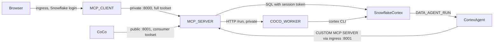

# Plan: Step 2, Cortex and Snowflake patterns around the SPCS MCP server

Prove that Snowflake can call an MCP server we host in SPCS, then put Cortex behind that server, so step 3 can drop a mock Factory app behind the same server and demo Snowflake agents using Factory tools next to Snowflake data.

## Bottom line

The demo needs Snowflake (CoCo and Cortex Agents) calling an MCP server, so that direction is proven first, as a spike right after Snowflake connectivity, using the existing `add` tool. The highest-value unknown is whether `CREATE CUSTOM MCP SERVER`, documented only for Native Apps, works in a standalone account; the answer shapes step 3, so it has an explicit go/no-go. After that, the outbound Cortex tools you picked (AI SQL functions, `DATA_AGENT_RUN`, managed coding agent, `COCO_WORKER` with the Cortex Agent SDK) all go through SQL with the container's session token, which never leaves Snowflake. REST paths are out of scope by decision. Every pattern that works, and its grants, lands in a `PATTERNS.md` you can reuse.

## Context

**Step 1 state (on `main`):** `MCP_SERVER` (Python `mcp` 2.3, stateless Streamable HTTP, private endpoint `mcp` :8000) and `MCP_CLIENT` (Node monitor, public endpoint `ui` :8080) in `MCP_SPCS_DEMO.APP`, owned by `MCP_DEMO_ROLE`, on `MCP_DEMO_POOL` (CPU_X64_XS, 1 vCPU, 6 GiB, 0.5 vCPU already requested). Tools: `add` only. Host-header allow-list via `MCP_ALLOWED_HOSTS` in [mcp-server/src/mcp_server/server.py](mcp-server/src/mcp_server/server.py).

**Key findings from the docs research (2026-11-13):**
- SQL from SPCS: `/snowflake/session/token` plus `SNOWFLAKE_HOST`, no egress setup, runs as the service owner role. Needs a warehouse (`QUERY_WAREHOUSE`) and `SNOWFLAKE.CORTEX_USER`.
- `DATA_AGENT_RUN('<agent>', <json>)`: one aggregated JSON result, 15 min sync limit, warning code 399569 when a tool is inaccessible.
- Managed coding agent: `AGENT_RUN` with an inline spec using `code_toolset_all` (Cortex Code runtime in a Snowflake sandbox); unattended calls need `permission_policy: always_allow`. Signature to confirm at build time.
- `snowflake-cortex-agent-sdk` 0.0.3 (`cortex_agent_sdk.cortexcode.query`) drives a local `cortex` CLI; SPCS can generate `connections.toml` via `sessionTokenConfig.mountConnectionConfig: true`, but CLI support for it is unverified.
- Cortex Agents call an SPCS MCP server through `CREATE CUSTOM MCP SERVER ... SERVICE=... ENDPOINT=... PATH='/mcp'` and `mcp_servers` in the agent spec. Calls go to the endpoint's **ingress URL**, so the endpoint must be public. The invoking role needs `USAGE` on the object and access to the service endpoint, checked on every `tools/list` and `tools/call`. `SHOW CUSTOM MCP SERVERS IN ACCOUNT` runs here (0 rows); standalone `CREATE` is unverified.
- CoCo: `cortex mcp add <name> <url> --type http --snowflake-connection <conn>` injects a Snowflake session token. Local CLI v1.2.44 supports headless `cortex -p ... --mcp-config '<json>' --only-explicit-mcp-servers --allowed-tools ...`, so tests need not touch `~/.snowflake/cortex/mcp.json`.
- The account already has 38 agents and managed MCP servers `MCP.SERVERS.CLAUDE` and `MCP.SERVERS.HOUSEKEEPING` (not used by this plan).

## Patterns map

**A. Snowflake calls our MCP server (the demo direction)**

| Pattern | Mechanism | Status | Step 2 |
|---|---|---|---|
| A1 CoCo as MCP client | `cortex mcp add ... --snowflake-connection`, or headless `--mcp-config` | Documented | **Build** (Stage 2) |
| A2 Cortex Agent via SPCS-hosted MCP | `CREATE CUSTOM MCP SERVER` + `mcp_servers` in the agent spec | Native App docs only; standalone **unverified** | **Spike with go/no-go** (Stage 2) |
| A3 Snowflake Intelligence | Same agent surfaced in the UI | Should follow from A2; not tested | Note only |
| A4 Production analogue for the real Factory | `CREATE API INTEGRATION ... API_PROVIDER = EXTERNAL_MCP` (OAuth) + `CREATE EXTERNAL MCP SERVER URL=...`; CoCo pointed directly at Factory's URL | Documented; tools only, OAuth only | Document in `PATTERNS.md`; the SPCS mock cannot prove this path |
| A5 SQL via service function | `CREATE FUNCTION ... SERVICE=MCP_SERVER ENDPOINT=...` on a non-JSON-RPC route | Documented; agent use of service functions unverified | Fallback for A2 only |

**B. Our MCP server calls Cortex**

| Pattern | Mechanism | Status | Step 2 |
|---|---|---|---|
| B1 AI SQL functions | `AI_COMPLETE`, `AI_CLASSIFY`, `AI_SENTIMENT` over the connector | Documented | **Build** (Stage 3) |
| B2 Agent via SQL | `DATA_AGENT_RUN` | Documented | **Build** (Stage 5) |
| B3 Managed coding agent | `AGENT_RUN` + `code_toolset_all` | Documented; signature to confirm | **Build** (Stage 6) |
| B4 Self-hosted Cortex Code | `COCO_WORKER` service with `snowflake-cortex-agent-sdk` + pinned `cortex` CLI | SDK documented; SPCS auth unverified | **Build** (Stage 7) |
| B5 REST (`agent:run`, chat completions, Search, Analyst, managed MCP proxy) | Bearer token to `/api/v2/...` | Out of scope by decision | Deferred |
| B6 AGENT TASK automations | Scheduled Cortex Code runs | Hourly minimum, ~3 min runs | Rejected |

**C. Identity:** all calls run as `MCP_DEMO_ROLE` (outbound) or as the invoking Snowflake user (inbound via ingress). Caller's rights across the client-to-server hop is an optional spike (Stage 9).

## Target architecture



### Two toolsets on two endpoints
- **Private `mcp` endpoint, port 8000, full toolset:** `add`, `snowflake_whoami`, Cortex tools, `ask_agent`, `ask_coding_agent`, `coco_task`. Only `MCP_CLIENT` and probe jobs use it.
- **Public `mcp-public` endpoint, port 8001, consumer toolset:** `add` now, the Factory tools in step 3. This is what CoCo and Cortex Agents see.
- Why: with one toolset, a Cortex Agent registered against our server would see `ask_agent` and `coco_task` and could recurse into itself (Snowflake caps nesting at 10, but each hop costs tokens). The split also matches step 3, where Factory tools are exactly the consumer toolset.
- Implementation: both toolsets are `MCPServer` instances registering shared tool functions, served by two uvicorn servers in one process ([mcp-server/src/mcp_server/__main__.py](mcp-server/src/mcp_server/__main__.py)). The public app adds the ingress hostname to its host allow-list.

### Inbound call log
The server records every tool call with: endpoint (private or public), tool, args, result, latency, and the `Sf-Context-Current-User` header that Snowflake ingress adds to public requests (expected per docs, verified in Stage 2). It exposes `GET /calls?since=` on the private port only. The monitor gets an **Inbound (Snowflake)** view, which is both the spike's evidence and the demo's "watch Snowflake call Factory" screen.

### Snowflake connectivity
[mcp-server/src/mcp_server/snowflake.py](mcp-server/src/mcp_server/snowflake.py) (new):
- **In SPCS:** `snowflake.connector.connect(host=SNOWFLAKE_HOST, account=SNOWFLAKE_ACCOUNT, token=<file, re-read per connect>, authenticator="oauth")`, warehouse from `QUERY_WAREHOUSE`.
- **Locally:** `connection_name=$SNOW_CONNECTION`, then `USE ROLE MCP_DEMO_ROLE; USE SECONDARY ROLES NONE; USE WAREHOUSE MCP_DEMO_WH`. Your user has `DEFAULT_SECONDARY_ROLES = ALL`, which would hide grants SPCS will enforce.
- **`QueryRunner.run(sql, params, timeout_s) -> (rows, query_id)`** runs in a worker thread (`anyio.to_thread`) so a slow agent call does not block other requests. Bind variables only.

### Tool contracts (full toolset)

| Tool | Inputs | Output | Limits |
|---|---|---|---|
| `snowflake_whoami` | none | user, role, warehouse, query_id | 30 s |
| `cortex_complete` | `prompt`, `model` (allow-list) | text, model, query_id | prompt ≤ 8,000 chars; 120 s |
| `cortex_classify` | `text`, `categories` (2 to 20) | label, query_id | 60 s |
| `cortex_sentiment` | `text` | sentiment, query_id | 60 s |
| `ask_agent` | `question`, optional `agent` (allow-list, default `MCP_SPCS_DEMO.APP.MCP_DEMO_AGENT`) | answer, tool_uses, warnings, run_id, query_id | MCP timeout 5 min |
| `ask_coding_agent` | `task`, optional `max_seconds` | answer, tool calls summary, warnings, query_id | budget ≤ 600 s |
| `coco_task` | `prompt`, optional `max_turns` | answer, turns, usage, permission denials | worker caps wall clock and turns |

Errors come back as `is_error` results with the Snowflake error code and query_id, like `add` today.

### Client changes
[mcp-client/](mcp-client/) changes:
- **Schema-driven forms:** one form per discovered tool, generated from its `inputSchema`.
- **Async jobs:** `POST /api/jobs {tool, args}` returns 202 at once, and the MCP call runs in the background with a per-tool timeout (default 120 s; 15 min for agent and CoCo tools). No browser request ever waits on Cortex, so the 90 s ingress idle limit cannot cut a call.
- **Call log:** gains a `running` state and a revision counter, so the UI polls `?sinceRev=` and updates entries in place.
- **Inbound (Snowflake) tab:** proxied from the server's private `/calls`.
- **Traffic generator:** stays hard-wired to `add`, with a test.

---

## Implementation steps

### Stage 0: Branch and prerequisites
1. `git checkout -b feature/cortex-tools`.
2. [spcs/01_cortex_setup.sql](spcs/01_cortex_setup.sql) (ACCOUNTADMIN, re-runnable):
   - `MCP_DEMO_WH` (XSMALL, auto-suspend 60, initially suspended), owned by `MCP_DEMO_ROLE`.
   - `GRANT DATABASE ROLE SNOWFLAKE.CORTEX_USER TO ROLE MCP_DEMO_ROLE`.
   - Confirm `USE AI FUNCTIONS` is still granted to PUBLIC.
   - `ALTER SERVICE MCP_SERVER SET QUERY_WAREHOUSE = MCP_DEMO_WH`.
3. Pick the model allow-list from what is available in AWS us-east-1.

### Stage 1: Snowflake connectivity
`snowflake.py`, `QueryRunner` with a fake for tests, `snowflake_whoami`. Extend [mcp-server/src/mcp_server/probe.py](mcp-server/src/mcp_server/probe.py) with `--tool <name> --args <json> --expect <key=value>` so one probe job can check any tool. Build and deploy `v3`.

### Stage 2: Spike, Snowflake calls our MCP server
1. **Consumer toolset:** split into private (8000) and public (8001) toolsets as above, add the inbound call log and private `/calls`, add endpoint `mcp-public` (port 8001, `public: true`) to [spcs/mcp-server.spec.yaml](spcs/mcp-server.spec.yaml), deploy `v4`, then add the new ingress hostname to the public app's allow-list (`MCP_PUBLIC_ALLOWED_HOSTS`) and redeploy.
2. **A1, CoCo:** headless run, with no change to your personal MCP config:
   ```bash
   cortex -p "Use the add tool to compute 2 + 3. Reply with only the number." \
     -c "$SNOW_CONNECTION" --only-explicit-mcp-servers \
     --mcp-config '{"mcpServers":{"spcs_demo":{"type":"http","url":"https://<public-ingress>/mcp","snowflake_connection":"<conn>"}}}' \
     --allowed-tools mcp__spcs_demo__add --output-format stream-json
   ```
   Confirm the `snowflake_connection` field name in `--mcp-config` at build time; the documented fallback is `cortex mcp add ... --snowflake-connection` followed by `cortex mcp remove` afterwards. You can repeat it in CoCo Desktop manually.
3. **A2, Cortex Agent:** [spcs/02_agent_mcp.sql](spcs/02_agent_mcp.sql):
   - `CREATE CUSTOM MCP SERVER MCP_SPCS_DEMO.APP.MCP_SERVER_PUBLIC SERVICE = MCP_SPCS_DEMO.APP.MCP_SERVER ENDPOINT = "mcp-public" PATH = '/mcp'`.
   - `CREATE AGENT MCP_SPCS_DEMO.APP.MCP_DEMO_AGENT`: `orchestration: auto`, short instructions, `mcp_servers: [{server_spec: {name: MCP_SPCS_DEMO.APP.MCP_SERVER_PUBLIC}}]`. Create it with the `agent-studio` skill.
   - Run as `MCP_DEMO_ROLE`: `SELECT TRY_PARSE_JSON(SNOWFLAKE.CORTEX.DATA_AGENT_RUN('MCP_SPCS_DEMO.APP.MCP_DEMO_AGENT', $${"messages":[{"role":"user","content":[{"type":"text","text":"What is 19.5 + 22.5? Use the add tool."}]}]}$$))`.
4. **Least-privilege consumer recipe:** create `MCP_DEMO_CONSUMER_ROLE`, grant only what the docs list (`USAGE` on database, schema, agent, and custom MCP server; `GRANT SERVICE ROLE MCP_SERVER!ALL_ENDPOINTS_USAGE`; `SNOWFLAKE.CORTEX_USER`), and rerun step 3 as that role. This becomes the grant recipe in `PATTERNS.md`.
5. **Go/no-go (decision with you):** if `CREATE CUSTOM MCP SERVER` is rejected outside a Native App, or the agent cannot reach the endpoint, the fallbacks are:
   - (a) package the server as a Native App for step 3;
   - (b) a Cortex Agent `generic` tool backed by a procedure that calls a service function on a new non-MCP route (A5);
   - (c) CoCo-only demo.

   We pick before Stage 3.

### Stage 3: AI SQL function tools
`cortex_complete`, `cortex_classify`, `cortex_sentiment` in [mcp-server/src/mcp_server/cortex_tools.py](mcp-server/src/mcp_server/cortex_tools.py), full toolset only. Load `cortex-ai-function-studio` and `sql-author` before writing the SQL.

### Stage 4: Client generic runner, async jobs, inbound view
Implement the client changes above. Deploy client `v2`.

### Stage 5: `ask_agent` round trip
`ask_agent` calls `DATA_AGENT_RUN` on the allow-listed `MCP_DEMO_AGENT` from Stage 2 and parses `content[]` into answer, tool uses, and warnings. Capture one real response as a sanitized test fixture. The full chain is monitor, then `MCP_SERVER` private `ask_agent`, then Cortex Agent, then `MCP_SERVER` public `add`. That proves both directions in one call without recursion, because the consumer toolset has no `ask_agent`.

### Stage 6: Managed coding agent
Confirm the `AGENT_RUN` signature and the `code_toolset_all` spec fields. `ask_coding_agent` sends an inline spec with `permission_policy: always_allow`, a seconds budget, and instructions to stay read-only inside `MCP_SPCS_DEMO`. Blast radius is `MCP_DEMO_ROLE`, which owns only the demo database; the sandbox SQL tool is SELECT and SHOW only.

### Stage 7: COCO_WORKER
1. **Service:** [coco-worker/](coco-worker/) is a Python Starlette app with `POST /run`, `GET /healthz` and `GET /selfcheck`. It runs `cortex_agent_sdk.cortexcode.query`:
   - with a read-only `allowed_tools` set, a `can_use_tool` deny callback and a max-turns cap;
   - one run at a time, with 429 when busy.
2. **Image:** SDK pinned, `cortex` CLI at a pinned version, auto-update off, non-root user.
3. **Pool:** [spcs/03_coco_pool.sql](spcs/03_coco_pool.sql) creates `MCP_COCO_POOL` (CPU_X64_XS, initially suspended).
4. **Auth:**
   - (a) `sessionTokenConfig.mountConnectionConfig: true`, using connection `default`.
   - (b) If (a) fails: a dedicated service user with a PAT in a Snowflake `SECRET`. This creates a user and a credential, so I stop and confirm with you first.
5. **Tool:** `coco_task` in the full toolset POSTs to `http://coco-worker:8000/run`.

### Stage 8: Operations, PATTERNS.md, PR
- **Scripts:** extend `suspend.sql`, `resume.sql` and `99_teardown.sql` for the worker, pools, warehouse, agent, custom MCP server and consumer role. Extend `smoke_spcs.py` per tool.
- **Cost query:** join logged query_ids with `CORTEX_AI_FUNCTIONS_USAGE_HISTORY` and `CORTEX_AGENT_USAGE_HISTORY`.
- **[PATTERNS.md](PATTERNS.md):** one section per pattern (A1, A2, A4, B1 to B4) with what works, exact DDL and grants, auth, limits, cost notes and the evidence from this branch. Mark A4 as documented but untested.
- **Wrap-up:** update the README, run the identifier scrub, and open a PR from `feature/cortex-tools`.

### Stage 9 (optional): Caller's-rights spike
`executeAsCaller: true` on `MCP_CLIENT`; forward `Sf-Context-Current-User-Token` to the private endpoint; try pairing it with `MCP_SERVER`'s own session token; run `snowflake_whoami`. Go/no-go with you before any redesign.

## Verification

| Stage | Automated | In SPCS / manual |
|---|---|---|
| 0 | `SHOW GRANTS TO ROLE MCP_DEMO_ROLE` includes the warehouse and the CORTEX_USER database role | `AI_COMPLETE` returns text as `MCP_DEMO_ROLE` with secondary roles NONE |
| 1 | Unit: auth selection, token re-read, fake runner, error mapping. Live (`-m snowflake`, needs `SNOW_CONNECTION`): whoami shows `MCP_DEMO_ROLE`. Existing 15 server tests and `smoke_local.sh` still pass | Probe job runs whoami as the service user |
| 2 | Unit: public toolset lists only consumer tools; private lists all; public allow-list accepts the ingress host and rejects others; inbound log records endpoint and caller header | CoCo headless run returns 5; `DATA_AGENT_RUN` answer contains 42 with a tool use of `add`; inbound log shows both calls on the public endpoint with the calling user; consumer role run succeeds; go/no-go recorded |
| 3 | Unit with fake runner: SQL and binds, caps, model allow-list, error mapping. Live: one short call per tool | Probe job calls each tool |
| 4 | Node: job lifecycle, revisions, timeout, traffic only calls `add`; API test with a fake `slow_echo` tool returning 202 before completion; e2e against Python server | Browser: run `cortex_complete` from the generated form; Inbound tab shows agent calls |
| 5 | Parser against the fixture and edge cases (no text, warnings, error JSON); allow-list rejection | Full round trip from the monitor; inbound log shows the nested `add` call |
| 6 | Unit with fixture | "List and count the tables, views, and functions in MCP_SPCS_DEMO.APP" matches `SHOW`; check whether the run appears in `CORTEX_AGENT_USAGE_HISTORY` |
| 7 | Worker unit tests with fake `query()`: shaping, error result, 429, denial callback | `/selfcheck` passes in SPCS; `coco_task("How many tables are in MCP_SPCS_DEMO.APP?")` matches `SHOW` |
| 8 | Full suspend and resume regression (all services READY, every probe passes); identifier scan clean | PR open |

## Risks

| Risk | Caught in | Fallback |
|---|---|---|
| `CREATE CUSTOM MCP SERVER` not allowed outside Native Apps | Stage 2 step 3 | Go/no-go options (a) to (c) |
| Ingress forwards a Host header our allow-list rejects (421) | Stage 2 step 1, server logs | Add the exact forwarded host to `MCP_PUBLIC_ALLOWED_HOSTS` |
| Cortex Agent MCP client expects SSE rather than our JSON responses | Stage 2 step 3 | Turn off `json_response` on the public app only |
| `Sf-Context-Current-User` absent on agent-initiated calls | Stage 2 inbound log | Log what is present; identity proof falls back to Snowflake query history |
| Local tests pass on grants SPCS lacks | Stage 1 (secondary roles NONE) | Add grants to `01_cortex_setup.sql` |
| `AGENT_RUN` signature differs from research | Stage 6 step 1 | Use the managed MCP `CODING_AGENT` spec as reference |
| `cortex` CLI cannot use the SPCS session token | Stage 7 `/selfcheck` | PAT secret path after your confirmation |
| Cost creep | Traffic stays `add`-only; consumer toolset excludes Cortex tools; Stage 8 cost query | Suspend scripts |

## Critical files

- [mcp-server/src/mcp_server/server.py](mcp-server/src/mcp_server/server.py): split into shared tool registration plus private and public `MCPServer` apps, allow-lists, inbound call log.
- [mcp-server/src/mcp_server/snowflake.py](mcp-server/src/mcp_server/snowflake.py) (new): connection factory and `QueryRunner`, the foundation of every outbound Cortex tool.
- [spcs/mcp-server.spec.yaml](spcs/mcp-server.spec.yaml): second endpoint `mcp-public`, `QUERY_WAREHOUSE`, allowed hosts.
- [spcs/02_agent_mcp.sql](spcs/02_agent_mcp.sql) (new): custom MCP server, demo agent, consumer role grants; the core reusable pattern for step 3.
- [mcp-client/src/app.js](mcp-client/src/app.js): async jobs, generic tool runs, inbound view proxy.
