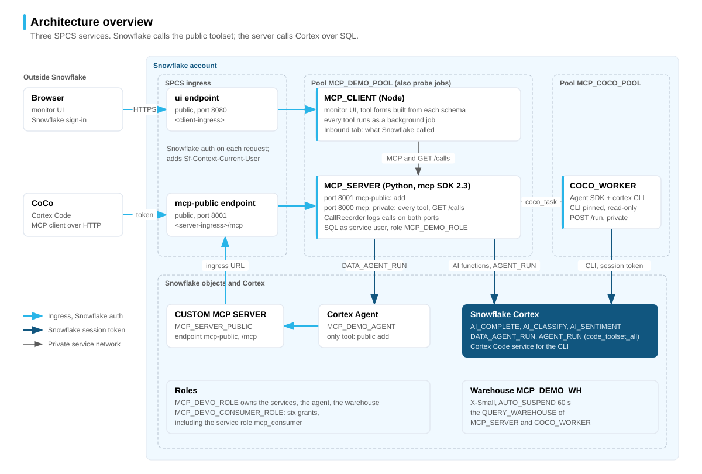
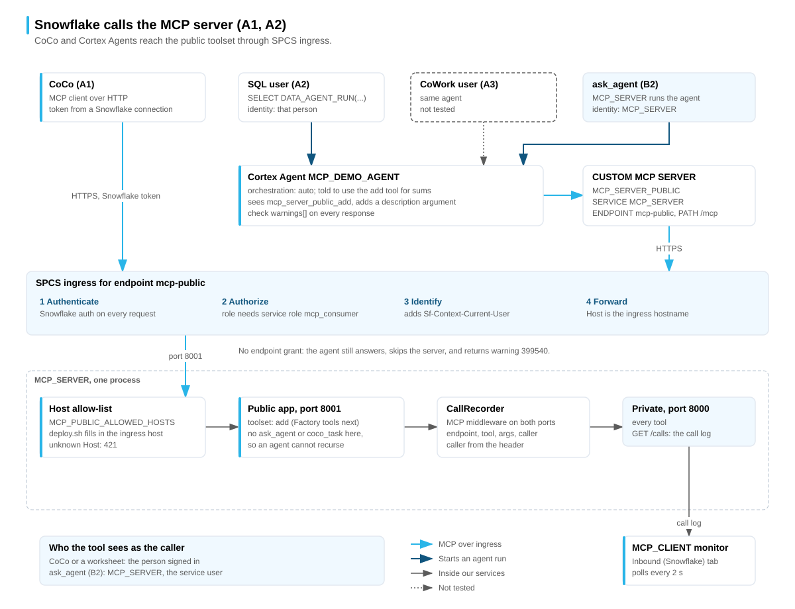
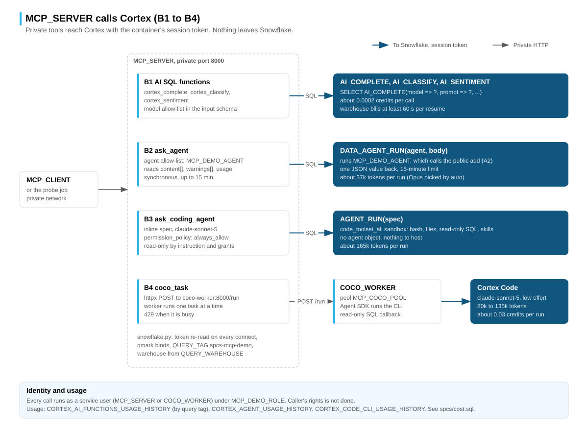
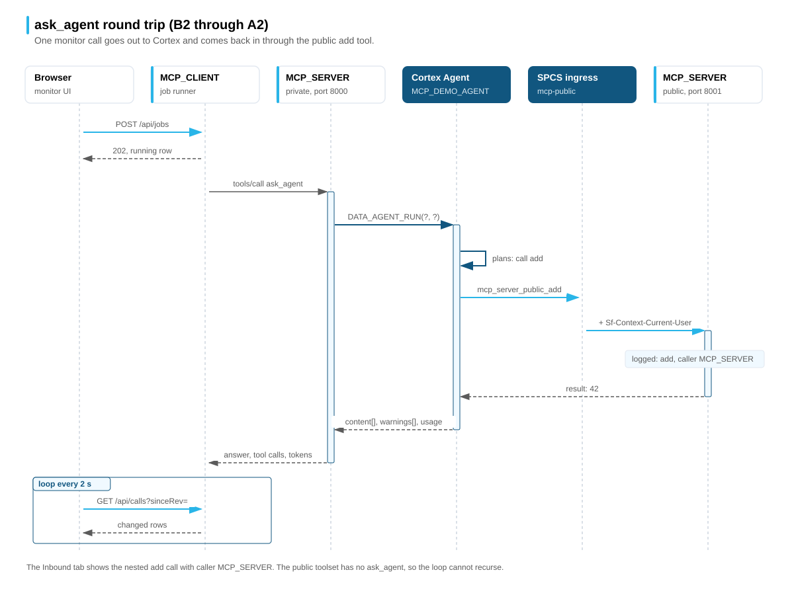
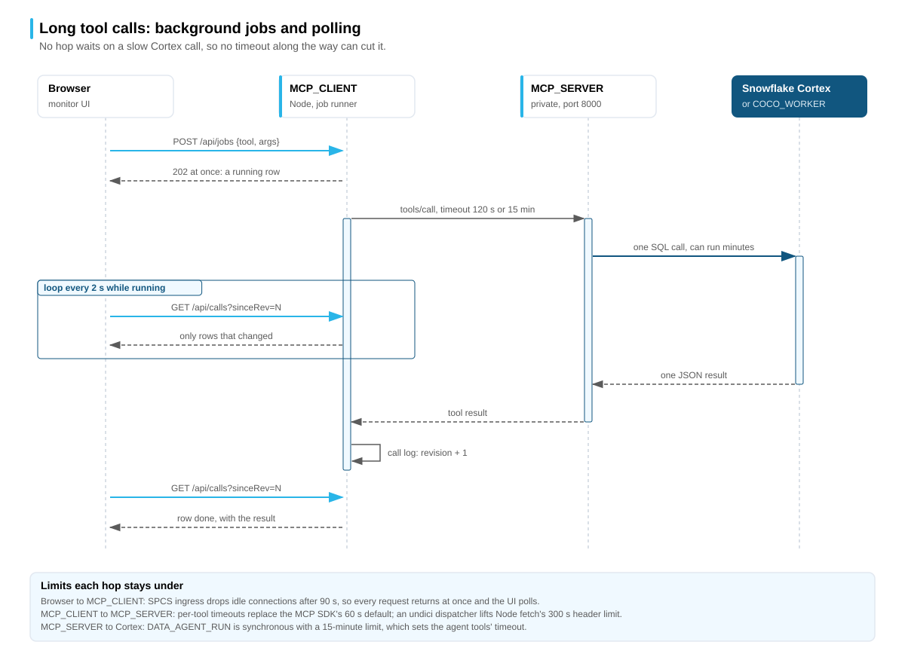

# Architecture diagrams

Five views of what runs on branch `feature/cortex-tools`. Pattern IDs (A1 to A4, B1 to B4) match
[PATTERNS.md](../PATTERNS.md), which has the DDL, grants, and evidence behind each box.

How to read them:

- **Snowflake Blue arrows:** traffic through SPCS ingress, authenticated by Snowflake.
- **Mid-Blue arrows:** calls into Snowflake on a session token.
- **Gray arrows:** the private service network. Dashed arrows are replies, and dotted ones are untested.
- **Mid-Blue boxes:** run by Snowflake. Boxes with a blue bar are ours.
- `<client-ingress>` and `<server-ingress>` stand for account-specific hostnames.
  `SHOW ENDPOINTS IN SERVICE MCP_SPCS_DEMO.APP.<service>` lists them.

The SVGs are generated. To change one, edit [`diagrams/build.py`](diagrams/build.py) (standard library
only) and run `python3 docs/diagrams/build.py`.

## 1. Overview

Three services on two compute pools. The browser and CoCo come in through ingress. `MCP_SERVER`
calls Cortex over SQL and hands CLI work to `COCO_WORKER`. The agent reaches back into the public
endpoint through the custom MCP server object.

## 2. Snowflake calls the MCP server (A1, A2)

CoCo connects straight to the public endpoint. A Cortex Agent reaches it through
`CUSTOM MCP SERVER MCP_SERVER_PUBLIC`. Ingress authenticates the caller, checks the `mcp_consumer`
service role, and adds the caller's name. The server then checks the `Host` header and serves only
the public toolset, and every call lands in the log the monitor's Inbound tab reads.

## 3. MCP_SERVER calls Cortex (B1 to B4)

The private tools run SQL as the service user: AI functions, `DATA_AGENT_RUN`, and `AGENT_RUN`
with the code sandbox. `coco_task` hands work to `COCO_WORKER`, which drives the Cortex Code CLI.
Token and credit figures are from the demo account. See PATTERNS.md for how they were measured.

## 4. The ask_agent round trip

The one flow that uses both directions. A private `ask_agent` call starts the agent, the agent calls
the public `add` through ingress as `MCP_SERVER`, and the answer comes back as one JSON value.

## 5. Long tool calls

Agent tools can run for minutes. The monitor never holds a request open for that long: it starts a
background job and polls, and each hop's timeout is set so that it stays under its limit.

